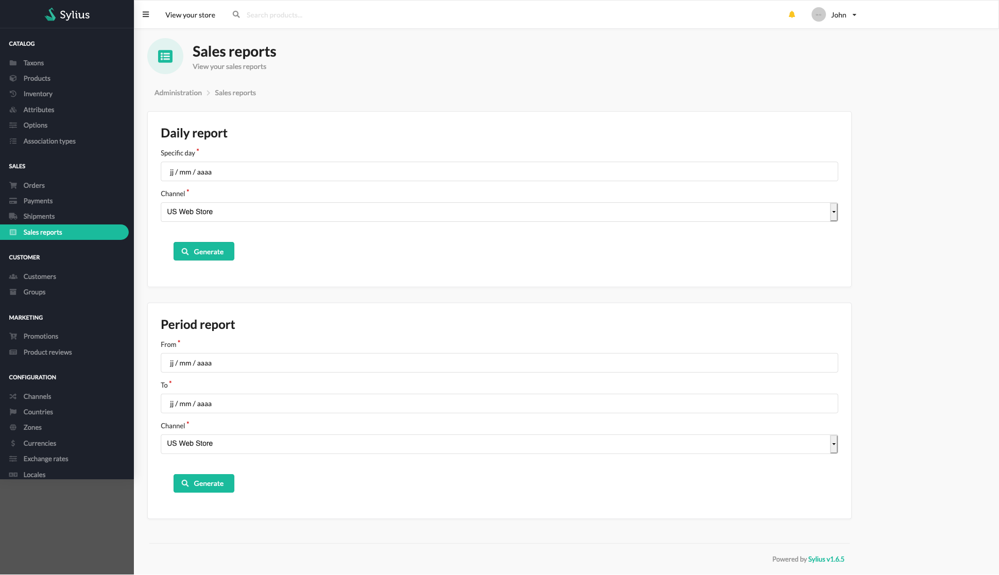
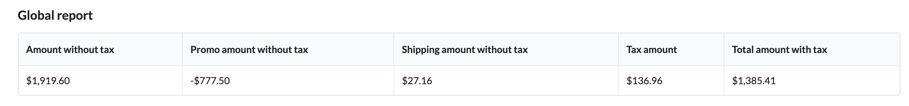
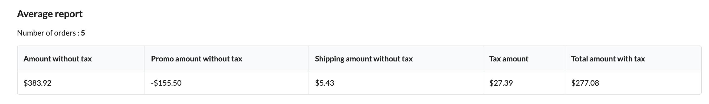
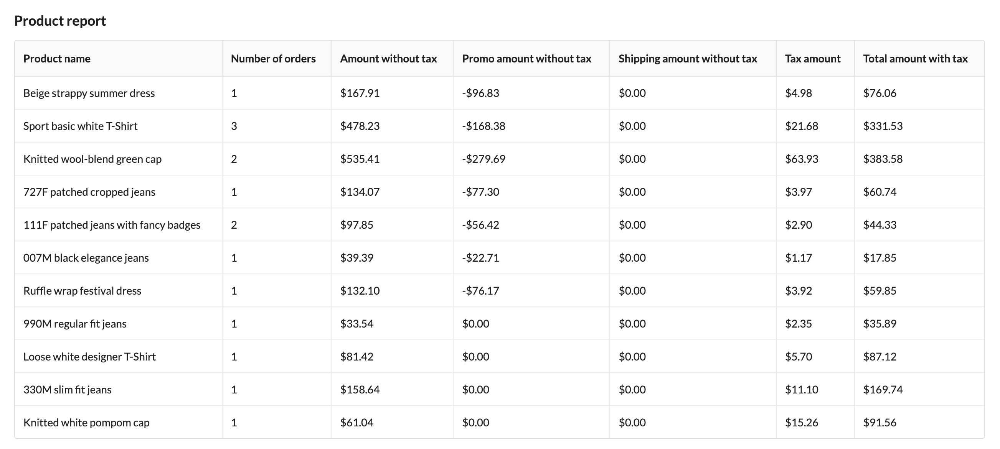
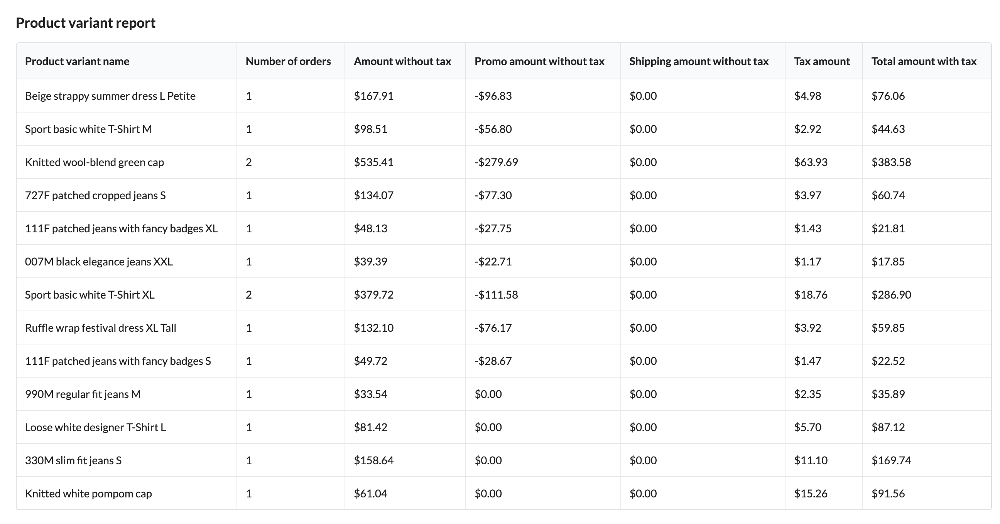
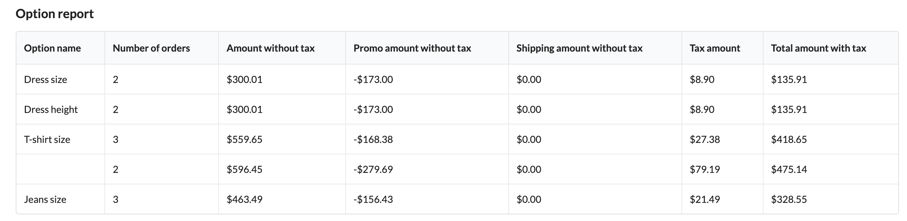
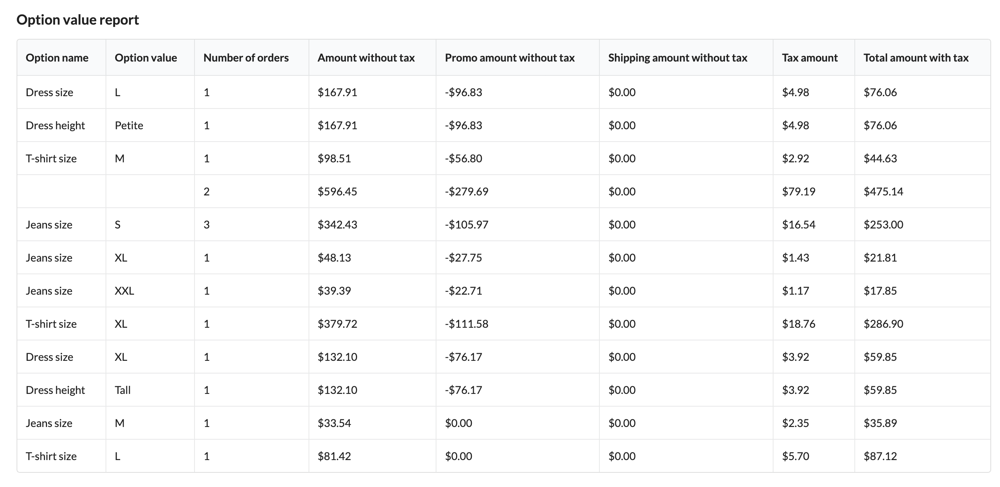

[](https://monsieurbiz.com/agence-web-experte-sylius)

<h1 align="center">Sylius Sales Reports</h1>

[](https://github.com/monsieurbiz/SyliusSalesReportsPlugin/blob/master/LICENSE.txt)
[](https://github.com/monsieurbiz/SyliusSalesReportsPlugin/actions?query=workflow%3ATests)
[](https://github.com/monsieurbiz/SyliusSalesReportsPlugin/actions?query=workflow%3ASecurity)
[](https://github.com/monsieurbiz/SyliusSalesReportsPlugin/actions?query=workflow%3ASecurity)


A simple plugin to have sales reports in Sylius



## Compatibility

| Sylius Version | PHP Version     |
|----------------|-----------------|
| 1.12           | 8.1 - 8.2 - 8.3 |
| 1.13           | 8.1 - 8.2 - 8.3 |
| 1.14           | 8.1 - 8.2 - 8.3 |

## Installation

If you want to use our recipes, you can configure your composer.json by running:

```bash
composer config --no-plugins --json extra.symfony.endpoint '["https://api.github.com/repos/monsieurbiz/symfony-recipes/contents/index.json?ref=flex/master","flex://defaults"]'
```

```bash
composer require monsieurbiz/sylius-sales-reports-plugin
```

Change your `config/bundles.php` file to add the line for the plugin : 

```php
<?php

return [
    //..
    MonsieurBiz\SyliusSalesReportsPlugin\MonsieurBizSyliusSalesReportsPlugin::class => ['all' => true],
];
```

Finally import the routes in `config/routes/monsieurbiz_sylius_sales_reports_plugin.yaml` : 

```yaml
monsieurbiz_sales_reports_plugin:
    resource: "@MonsieurBizSyliusSalesReportsPlugin/Resources/config/routing.yaml"
```

## Reports

All reports columns are sortable by clicking on it.

If you want to change order or payments states used in the reports, you can configure it in the `config/packages/monsieurbiz_sylius_sales_reports_plugin.yaml` file:

```yaml
parameters:
    monsieurbiz.sales_reports.order_states:
        - …
    monsieurbiz.sales_reports.payment_states:
        - …
```

(FYI, is it possible to use `!php/const` to use constants in the config file)

### How reports are calculated

The admin page still displays the same six built-in reports. It calls
`ReportRepository::getReportsForChannelForDates()` once to generate them together.

#### Why the calculation changed

Previously, each report repeated sales reads and loaded physical sales rows into
PHP. Annual reports could take too much time and memory. The database now computes
grouped sums and distinct order counts; PHP assembles these small results instead.
This removes repeated work rather than increasing timeouts or caching a report.

#### Current calculation

- Sales queries share the same channel, date, order-state and payment-state filters.
- Base amounts and adjustments are summed separately. Several matching adjustments
  therefore do not multiply base prices or taxes; equal adjustment amounts still count separately.
- Base prices use physical order-item units, while stored quantities and totals remain unchanged.
- Products and variants have independent distinct-order counts. Stored item names remain report labels.
- Option reads include only valid variant IDs present in the report. Historical items
  without variants still contribute to financial totals.

The standard, non-empty aggregate path with valid variants uses eight data queries
and three transaction-control statements. Empty reports or missing variants can use
fewer queries. No schema migration, additional index or persistent report cache is required.

#### Consistent database snapshot

All aggregate reads, including options, use one `REPEATABLE READ` transaction.
Changes committed after the first report read do not alter that report's remaining reads.
Isolation applies to the report transaction, not the session defaults.

This path supports MySQL/MariaDB and PostgreSQL. MySQL/MariaDB report tables must
use InnoDB; the plugin does not inspect their storage engines.
The order and variant repositories must share one DBAL connection, with autocommit
enabled and no active caller-owned transaction. The plugin checks the platform and
these connection conditions before starting the report transaction. Invalid values
raise a `LogicException`; the caller's transaction is not changed.

#### Customization and verification

The existing six public report methods remain available. Public report-method or
protected query/transformation overrides use compatibility paths. Enabled Doctrine
SQL filters also use filter-aware joins through a compatibility path. Their query
counts and transaction behavior can differ; the aggregate snapshot guarantee does
not apply to them. Custom reports can still use `CustomReportEvent` as described below.

See the [local benchmark instructions](tests/Performance/README.md) to verify the
calculation with 30,000 accepted annual orders by default, or at most 50,000, plus
four excluded control orders. This optional SQL benchmark is not an HTTP or
production latency guarantee and does not load fixtures automatically in CI.

### Global sales report



### Average sales report



### Product report



### Product variant report



### Option report



### Option value report



### Add your custom reports !

An event is available to add your custom reports, see `CustomReportEvent` class in the plugin.

## Contributing

You can open an issue or a Pull Request if you want! 😘  
Thank you!
